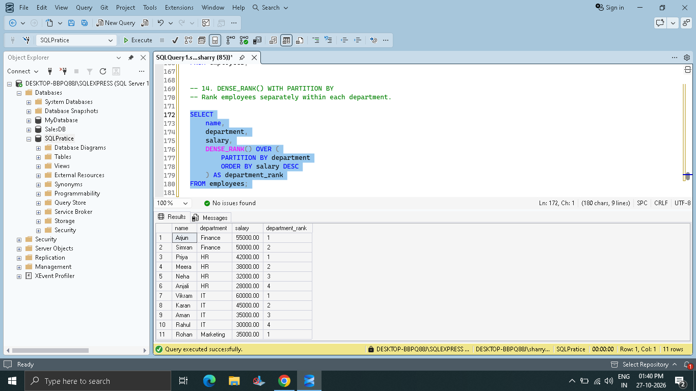
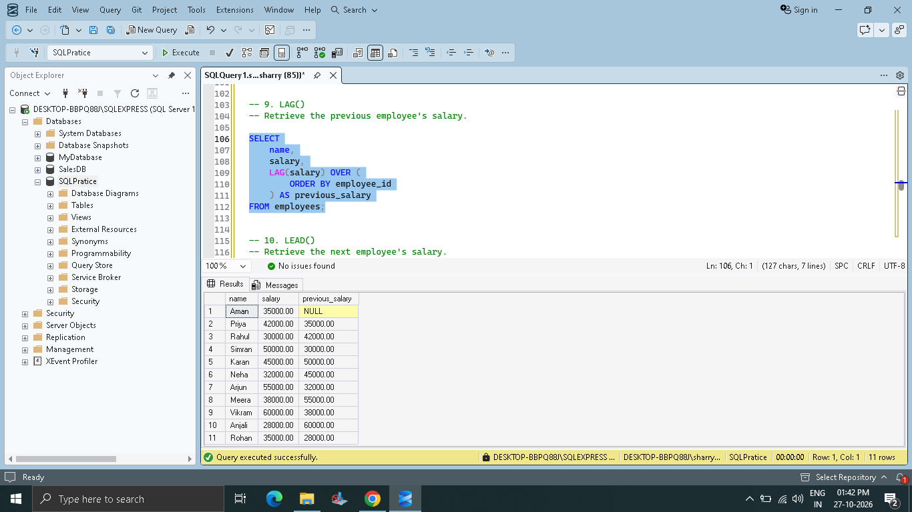
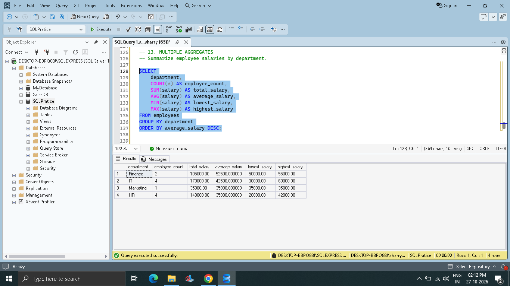
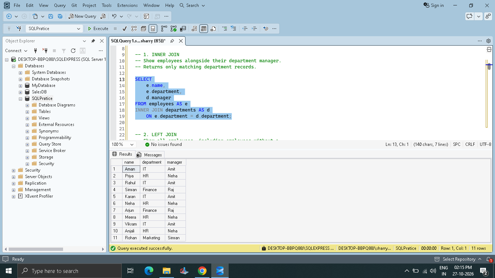
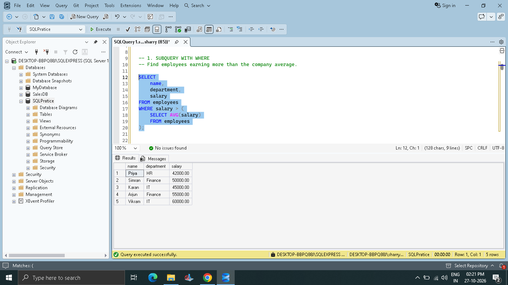

# Employee Data Analysis — SQL Server

## Project Overview

This beginner-friendly SQL portfolio project analyses a sample employee dataset using Microsoft SQL Server. It explores salaries, department statistics, employee locations, joining dates, joins, subqueries, and window functions.

The dataset is fictional and intended for learning and demonstration.

## How to Run the Project

1. Install Microsoft SQL Server and SQL Server Management Studio (SSMS), and connect to your SQL Server instance.
2. Create a new database, for example `EmployeeAnalysis`, and select it.
3. Run the scripts in this order:
   - `01_create_tables.sql` — creates the `employees` and `departments` tables.
   - `02_insert_sample_data.sql` — inserts the sample records.
4. Run any of the remaining analysis scripts:
   - `03_basics.sql`
   - `04_aggregates.sql`
   - `05_window_functions.sql`
   - `06_joins.sql`
   - `07_subqueries.sql`
   - `employee_analysis.sql`

**Important:** The setup scripts are for a fresh, empty project database. Do not rerun the table-creation or insert scripts on top of an already populated copy unless you first reset the tables/database. The scripts use SQL Server syntax.

## Database Tables

### `employees`

Contains employee ID, name, age, city, department, salary, and joining date.

### `departments`

Contains department names and their managers. The employee department column is linked to the departments table by a foreign key.

## SQL Skills Demonstrated

### SQL basics
- SELECT, WHERE, ORDER BY, DISTINCT
- BETWEEN, IN, LIKE, AND, OR
- NULL checks with IS NULL and IS NOT NULL
- CASE expressions

### Aggregate functions
- COUNT(), SUM(), AVG(), MIN(), MAX()
- GROUP BY and HAVING

### Joins
- INNER JOIN, LEFT JOIN, RIGHT JOIN, FULL OUTER JOIN
- SELF JOIN and CROSS JOIN
- Joins with filtering, ordering, and aggregation

### Subqueries
- Nested and correlated subqueries
- IN, NOT IN, EXISTS, and NOT EXISTS
- Comparing salaries against company and department averages
- Finding the fourth-highest distinct salary

### Window functions
- OVER() and PARTITION BY
- ROW_NUMBER(), RANK(), DENSE_RANK(), NTILE()
- Window aggregates
- LAG(), LEAD(), FIRST_VALUE(), LAST_VALUE()
- Running totals and window frames

## Questions Explored

1. How many employees are in the company?
2. What is the average salary across the company?
3. How many employees work in each department and city?
4. Which department has the highest average salary?
5. Which employees earn more than the company average?
6. Who is the highest-paid employee in each department?
7. Which employees joined after a specified date?
8. Which manager is associated with each employee's department?
9. What is the total salary expense for each department?
10. What is the fourth-highest distinct salary?
11. How can employees be ranked by salary within departments?
12. How can the previous or next employee's salary be retrieved?
13. How can running salary totals be calculated?
14. Which employees earn above their department's average?
15. How can departments without employees be found?

## Business Insights

The following observations are based on the 11 fictional employee records included in this project. They are descriptive findings from a small sample, not conclusions about a real company.

- **Finance has the highest average salary:** ₹52,500 across 2 employees.
- **IT has the largest department salary expense:** ₹170,000 across 4 employees. It also has the highest department headcount, tied with HR at 4 employees each.
- **HR and Marketing have the same average salary:** ₹35,000. HR has 4 employees, while Marketing has only 1, so the averages have different levels of representation.
- **Five employees earn above the overall average salary** of approximately ₹40,909.09.
- **Amritsar has the most employees** in this sample, with 5; Delhi and Ludhiana each have 3.
- **The highest individual salary is ₹60,000**, and the fourth-highest distinct salary is ₹45,000.

### What I noticed

- Finance has the highest average salary in this sample.
- Marketing has only one employee, so its average is based on just one salary.
- This is a small practice dataset, so the results show what I learned from SQL rather than how a real company pays its employees.

## Project Files

| File | Purpose |
|---|---|
| `01_create_tables.sql` | Creates the tables and relationship |
| `02_insert_sample_data.sql` | Inserts sample data |
| `03_basics.sql` | Basic queries and filtering |
| `04_aggregates.sql` | Aggregates, GROUP BY, and HAVING |
| `05_window_functions.sql` | Window functions |
| `06_joins.sql` | Join examples |
| `07_subqueries.sql` | Subquery examples |
| `employee_analysis.sql` | Business-style employee analysis |

## Dataset

The sample data contains 11 employees across four departments: IT, HR, Finance, and Marketing. All records are fictional.

## Screenshots

### 1. Total Employees

### 2. Average Salary by Department

### 3. Fourth-Highest Distinct Salary

### 4. Window Function — Department Ranking

### 5. Window Function — Previous Employee Salary

### 6. Aggregate Functions

### 7. INNER JOIN

### 8. Subquery — Employees Earning Above Average

## Tools Used

- Microsoft SQL Server
- SQL Server Management Studio (SSMS)
- Git and GitHub

## Purpose

This project demonstrates practical SQL skills for entry-level data analyst opportunities, including data retrieval, filtering, aggregation, joins, subqueries, and window functions.
